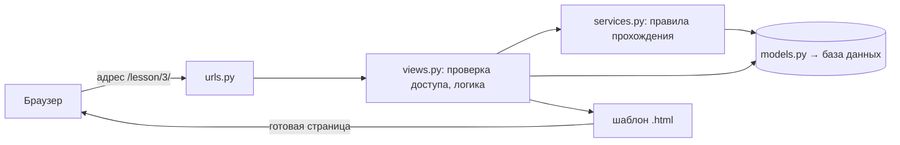
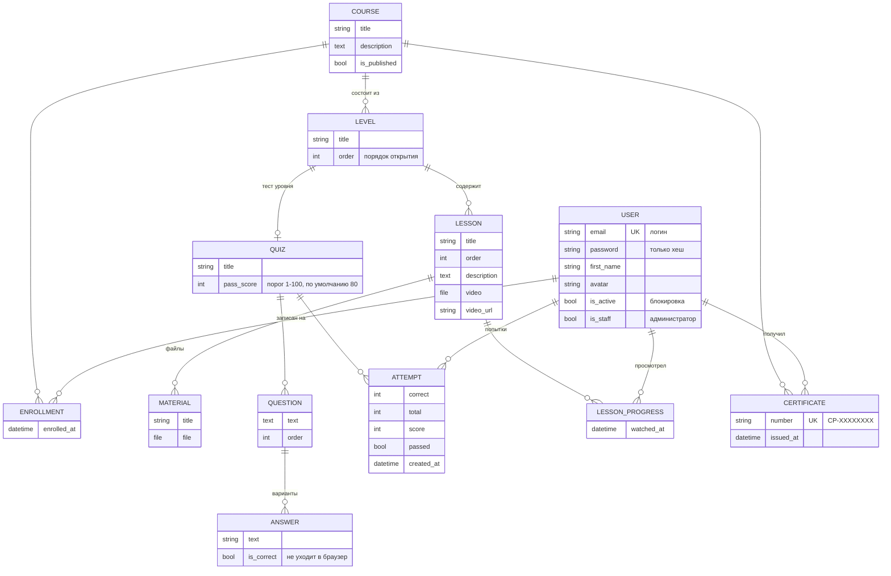
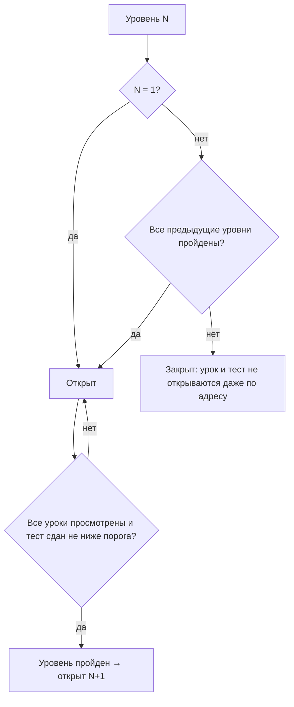
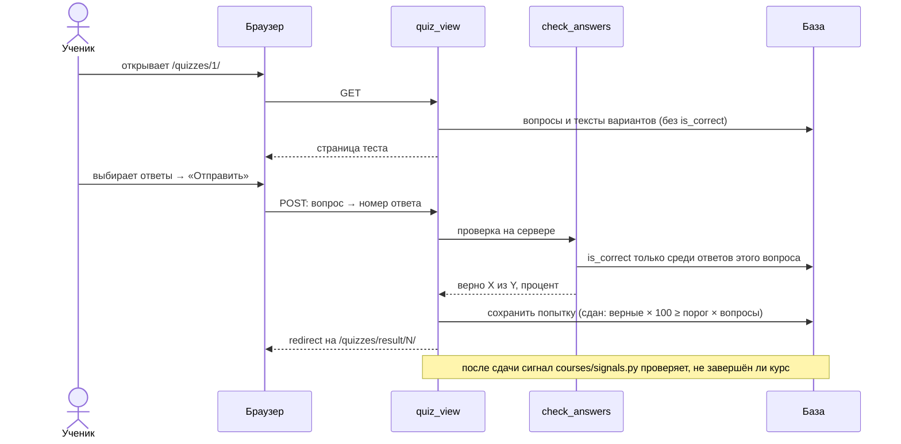

# Пояснительная записка

Веб-платформа онлайн-обучения «Course Platform». По ГОСТ 19.404-79.
Разработчики: Акматалиева Нургуль (1-й разработчик), Токсонбаева Фатима (2-й разработчик), группа ПИ(б)-2-24, КГТУ им. И. Раззакова.

## 1. Введение

Платформа предназначена для самостоятельного дистанционного обучения по готовым видеокурсам. Учётную запись создаёт администратор, логин и пароль приходят пользователю на e-mail. Обучающийся записывается на курс и проходит его по уровням: смотрит уроки, сдаёт тест; следующий уровень открывается только после успешной сдачи. После последнего уровня выдаётся сертификат.

Основание для разработки — учебный план дисциплины «Командная разработка» и техническое задание (ГОСТ 19.201-78).

## 2. Назначение и область применения

Платформа подходит любой онлайн-школе, учебному центру или автору курсов. Живого преподавателя в процессе обучения нет: содержимое готовит и публикует администратор через свою панель.

| Роль | Что делает |
| --- | --- |
| Гость | смотрит каталог и карточки курсов, входит, восстанавливает пароль, проверяет сертификат по номеру |
| Обучающийся | записывается на курсы, смотрит уроки, сдаёт тесты, видит свой прогресс и сертификаты, редактирует профиль |
| Администратор | создаёт учётные записи, наполняет курсы, уровни, уроки и тесты, блокирует пользователей, смотрит прогресс; курсы сам не проходит |

## 3. Технические характеристики

### 3.1. Технологии

| Компонент | Технология |
| --- | --- |
| Серверная часть | Python 3, Django 6.1 |
| Клиентская часть | шаблоны Django (HTML5, CSS3, JavaScript), адаптивная вёрстка, светлая и тёмная тема |
| База данных | SQLite при разработке, PostgreSQL на сервере (п. 4.4 ТЗ) |
| Почта | SMTP Gmail, пароль приложения хранится в файле `.env` вне Git |
| Контроль версий | Git, GitHub (ветки, pull request с взаимной проверкой) |

### 3.2. Архитектура

Django работает по схеме MTV (Model — Template — View). Запрос пользователя проходит одну и ту же цепочку:

Проект разделён на приложения по функциям ТЗ:

| Приложение | Функции ТЗ | Ответственная |
| --- | --- | --- |
| `accounts` | Ф-1 получение доступа, Ф-2 вход и выход, Ф-3 восстановление пароля, Ф-13 профиль | Нургуль |
| `quizzes` | Ф-9 прохождение теста, Ф-10 результат теста | Нургуль |
| `progress` | Ф-14 мой прогресс; общее правило открытия уровней | Нургуль |
| `courses` | Ф-4 каталог, Ф-5 карточка, Ф-6 запись, Ф-7 урок, Ф-8 отметка о просмотре, Ф-11 открытие уровня, Ф-12 сертификат | Фатима |
| `adminpanel` | А-1 – А-6 панель администратора | Фатима |
| `config`, `templates`, `static` | настройки, общий каркас страниц, стили | совместно |

Бизнес-логика вынесена из `views.py` в отдельные файлы `services.py`: `quizzes/services.py` (проверка ответов), `progress/services.py` (процент курса и открытые уровни), `courses/services.py` (отметка урока, следующий шаг, сертификат). Правило открытия уровней посчитано в одном месте — `course_progress()`, его используют урок, тест, результат, «Мой прогресс» и панель администратора, поэтому они никогда не противоречат друг другу.

## 4. Модель данных

Ограничения целостности: почта пользователя уникальна; запись на курс, отметка урока и сертификат уникальны для пары «пользователь — курс/урок» (`UniqueConstraint`), поэтому дублей не бывает; у уровня не больше одного теста (`OneToOneField`); удаление курса удаляет его уровни, уроки, тесты и записи (`on_delete=CASCADE`).

## 5. Ключевые алгоритмы

### 5.1. Открытие уровней (п. 4.1 ТЗ, Ф-11)

Процент курса = (просмотренные уроки + сданные тесты) / (все уроки + все тесты) × 100. Курс пройден, когда пройдены все уровни; тогда автоматически выдаётся сертификат с номером CP-XXXXXXXX.

### 5.2. Прохождение теста (Ф-9, Ф-10)

### 5.3. Отметка о просмотре (Ф-8)

Скрипт `static/js/lesson.js` складывает реально проигранные отрезки видео (`video.played`). Перемотанные куски туда не попадают. Когда набралось 90 % длительности, скрипт отправляет POST на `/lesson/<id>/watched/`. Сервер проверяет, что ученик записан на курс и уровень открыт, и сохраняет `LessonProgress`. У урока без видео или с видео YouTube — кнопка «Отметить урок как изученный».

## 6. Безопасность (п. 4.2 ТЗ)

- Пароли хранятся только хешем PBKDF2-SHA256; пароль новой учётной записи генерируется модулем `secrets`.
- Проверка ответов теста и правил открытия уровней — только на сервере; поле `is_correct` в браузер не передаётся.
- Все изменения — POST-формы с CSRF-токеном; выход, запись на курс, отметка урока и все действия админ-панели GET-запросом не выполняются.
- Функции администратора закрыты декоратором `staff_required`; обучающийся получает отказ.
- Чужой результат теста, чужой сертификат — 404; перенаправление `next` принимается только на адреса этого сайта.
- Некорректный ввод (пустые поля, неверный e-mail, неподходящий тип файла, порог вне 1–100 %, вопрос без правильного варианта) отклоняется с понятным сообщением.

## 7. Тестирование

125 автотестов (`python manage.py test`), все проходят. Подробности — в документе «Программа и методика испытаний».

## 8. Распределение работ

| Этап | Нургуль | Фатима |
| --- | --- | --- |
| Э1 — 20 % | Ф-1, Ф-2, Ф-3 | Ф-4 |
| Э2 — 40 % | Ф-13 | Ф-5, Ф-6 |
| Э3 — 60 % | Ф-9 | Ф-7 |
| Э4 — 80 % | Ф-10 | Ф-8, Ф-11, Ф-12 |
| Э5 — 100 % | Ф-14 | А-1 – А-6 |
| Совместно | модель базы данных, тестирование, документация, дополнительные функции п. 4.1.3 | |

Сверх обязательного объёма (п. 4.1.3): письмо «Ваш пароль изменён», реальная отправка писем через Gmail, светлая и тёмная тема, автоматический пиксельный аватар, проверка сертификата по номеру, запись ученика на курс администратором (и отчисление), команда `python manage.py dbinfo`.
